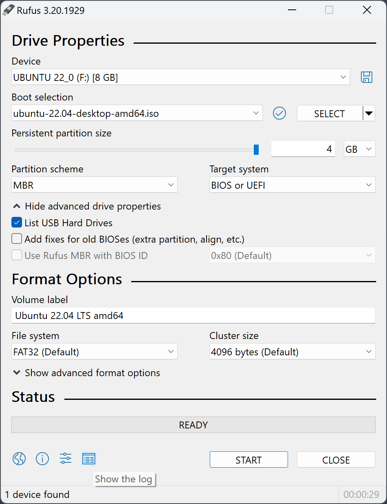
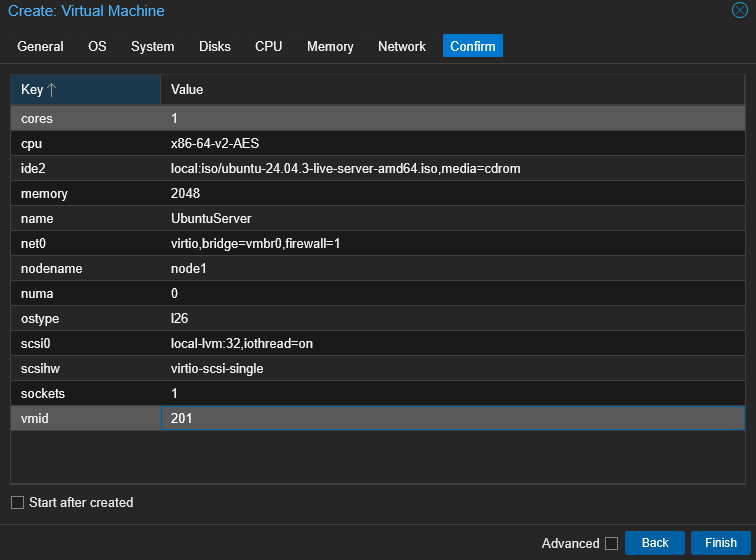

In order to create a VM, uploading an ISO image of the operating system you want to install is needed. Go to your storage on your **local node > ISO Images > Upload > Select File > Upload**

After uploading the ISO image of the desired operating system, creating a VM can be done. On the upper left click on Create VM. 

Below are the details of my created VM:

General
	Node: node1
	VM ID: 201
	Name: WebServer
OS
	ISO Image: Ubuntu Server 26.04.3
System
	 BIOS: OVMF (UEFI)
Disks
	Bus/Device: SCSI
	Storage: local-lvm
	Size: 32 GiB
CPU
	Sockets: 1
	Cores: 2
Memory
	Memory: 2048 MiB
Network
	Bridge: vmbr0

Then start installing your operating system.