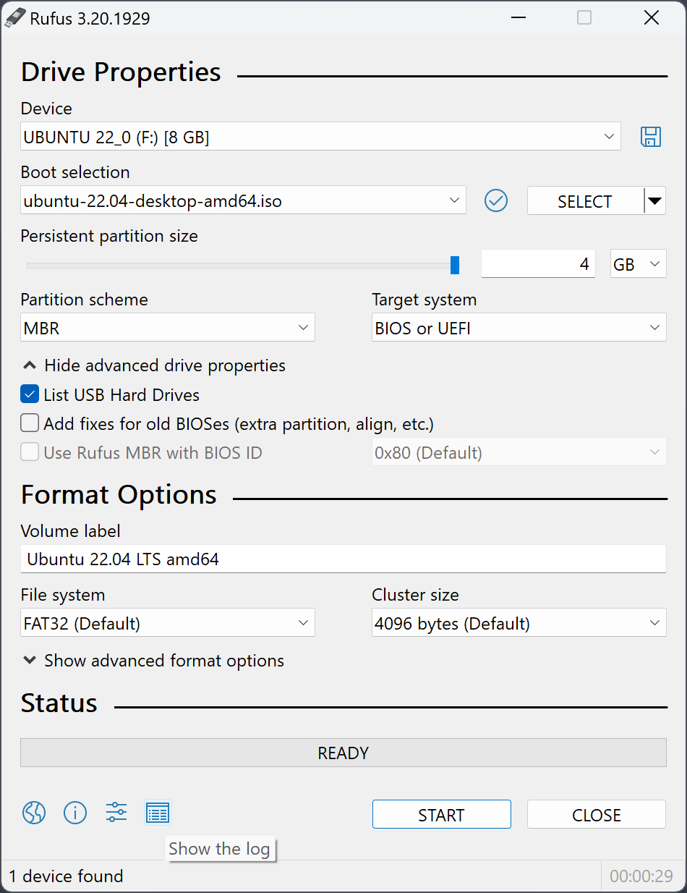
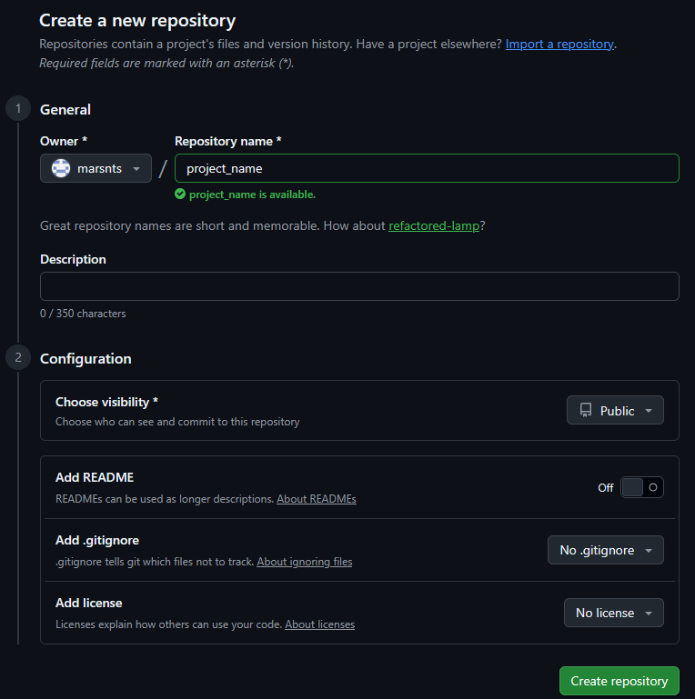

##### Creating a USB Flashdrive Installer (if you want a standalone system for a server)

You can install the Ubuntu Server 26.04 LTS image file using this [link](https://ubuntu.com/download/server) and use [rufus](https://rufus.ie/en/) and [balenaEtcher](https://etcher.balena.io/) to flash the image file into the USB flash drive for installation.

In my case, I used Rufus


Enter the BIOS/UEFI on your computer while the USB Flash drive with the installer plugged in. Boot from the USB Flash drive and install Ubuntu server to your liking but I would personally enable OpenSSH.
### Server Setup
###### Root Access

It is bad to log in as root. Applications are meant to be run with non-administrative security. Logging in directly as root removes all system safety rules. The root user has unlimited access to change, delete, or break anything on the systems. Thus creating a user with ``sudo`` privileges would make the CLI experience a bit more comfortable

###### Creating User with *sudo* Privileges

*sudo* stands for "**Superuser Do**", it lets users perform high-level tasks like installing software, repositories, packages, or changing system files without logging into the main administrator (root) account. ``sudo`` privileges allow a regular user to temporarily run computer commands with administrator (root) rights. 

Use the ``adduser`` command to add a new user to your system.
*Note: replace the `<name>` with any name*
```bash
adduser <name> 
```

Create and verify a password for the user.

Use the `usermod` command to add the user into the *sudo* group.
```bash
usermod -aG sudo <name>
```

With OpenSSH enabled, users can now log in to the server remotely within the local network.
```bash
ssh <name>@<IP Address>
```

Although every time `sudo` command was executed, it will ask for the user password. If you wanted to avoid being asked for the password every time you run `sudo` commands, we can edit the root configuration file.
```bash
sudo visudo
```
or
```bash
sudo nano /etc/sudoers
```
And add the following line to the sudoers list.
```bash
<name> ALL = NOPASSWD : ALL
```
This means that the user `<name>` can skip the password check for all tasks.

###### Logging in with SSH-Key

You can generate the SSH Key with this command if needed:
```bash
ssh-keygen
```

A prompt will appear asking if a password should be chosen for the SSH key. This step is optional and can be left blank.

At the end, copy the public key to the server:
```bash
ssh-copy-id -i ~/.ssh/id_rsa.pub <name>@<IP address>
```
*Note: `id_ed25519` and `id_rsa` is a Private key; should not be shared.  While `id_ed25519.pub` and `id_rsa.pub` is a Public Key; it is safe to share. `id_rsa` can be encountered in older machines while `id_ed25519` can be found in modern machines.*

Then enter the password. Logging in into the server without a password is now possible.

###### Disabling root login

Disabling direct root login prohibits hackers or non-authorized personnel from accessing the root. It forces individuals to log in with a normal user and use `sudo` to do administrative tasks. Disable root login thru ssh by editing `sshd_config` file.

```bash
sudo nano /etc/ssh/sshd_config
```

Review the file and look for the `PermitRootLogin` line.
```bash
PermitRootLogin yes
```
change `yes` to `no`
```bash
PermitRootLogin no
```
Save and close the file and restart sshd daemon to read the modified configuration.
```bash
sudo systemctl restart sshd
```

###### Firewall

Firewalld is installed by default in Ubuntu 26.04 LTS but users can always manually install firewalld:
```bash
sudo apt install firewalld
```
Enable firewall services and it will automatically start at boot.
```bash
sudo systemctl enable firewalld
```
Verify if firewall service is running and reachable.
```bash
sudo firewall-cmd --state
```
It should display:
```bash
running
```

To allow traffic of HTTP and HTTPS for interfaces in the "public" zone:
```bash
sudo firewall-cmd --zone=public --permanent --add-service=http
sudo firewall-cmd --zone=public --permanent --add-service=https
sudo firewall-cmd --reload
```
Verify if HTTP and HTTPS traffic is allowed:
```bash
sudo firewall-cmd --zone=public --permanent --list-services
```
It should display:
```bash
dhcpv6-client http https ssh
```

###### Installing Nginx

Install nginx by typing the following command:
```bash
sudo apt install nginx
```

Then enable the nginx service so it will start up automatically at boot:
```bash
sudo systemctl enable nginx
```

###### Installing Git

Installing git allows users to have version control over the system. Install Git using the following command:
```bash
sudo add-apt-repository ppa:git-core/ppa
sudo apt update
sudo apt install git
```

Setting the Git identity ensures identification who made changes to the repositories. You can configure the git identity using the following command:
```bash
git config --global user.name "Your Name"
git config --global user.email "your-email@example.com"
```

Confirm the set identity using the following:
```bash
git config --global --list
```
It will show `user.name` and `user.email` entered during configuration.

###### GitHub

Create an account at [github.com](https://github.com).

Create a new repository at the upper right section at GitHub:


Enter details:


At the Ubuntu system, run these commands to connect the local repository to GitHub. Set up your repository with Git beforehand.
```bash
git remote add origin https://github.com/your_GitHub_username/project_name
git branch -M main
git push -u origin main
```

`git remote add origin` connects local Git where the remote repository is located.
`origin` is the standard label for primary remote
`git branch -M main` renames your current branch to main if isn't already.
`git push -u origin main` uploads your entire commit history from local Git to GitHub.
`-u` flags the local branch to the remote so future pushes are simpler
	Note: replace `main` in `git push -u origin main` to push other branches

###### Docker (WIP)

Installing Docker allows containerization over your developed apps.

[https://docs.docker.com/engine/install/ubuntu/](https://docs.docker.com/engine/install/ubuntu/)

To fix docker permissions, use the following command:
```bash
sudo groupadd -f docker
sudo usermod -aG docker $USER
newgrp docker
```
This creates a docker group within the system and add active user to the docker group.

###### Java (WIP)

[https://sdkman.io/install](https://sdkman.io/install)

###### Node.JS (WIP)

[https://tecadmin.net/how-to-install-nvm-on-ubuntu-20-04/](https://tecadmin.net/how-to-install-nvm-on-ubuntu-20-04/)

### Setting up a Project / Repository

###### Creating a project / repository

Every project lives inside a folder. Creating a dedicated folder for projects and initializing Git so that Git can track everything inside it.

Move the path to the repository using:
```bash
cd ~/Desktop
```

Create a project folder using:
```bash
mkdir project_folder
cd project_folder
```

Create a markdown file to document the project:
```bash
sudo nano readme.md
```
Save then exit

Initialize Git within the repository using:
```bash
git init
git add readme.md
git commit -m "Add initial commit"
```

You can verify if the commit was saved:
```bash
git log
```

Every time changes are made and wanted to save it to your Git, always commit these changes.

To check if there are uncommitted changes, enter the following command:
```bash
git status
```
It should show `nothing to commit, working tree clean` , if every changes is committed. 